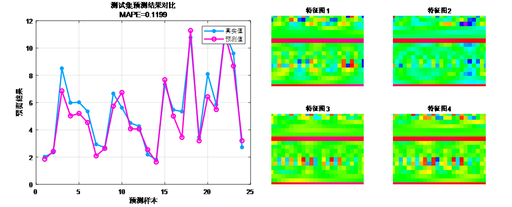
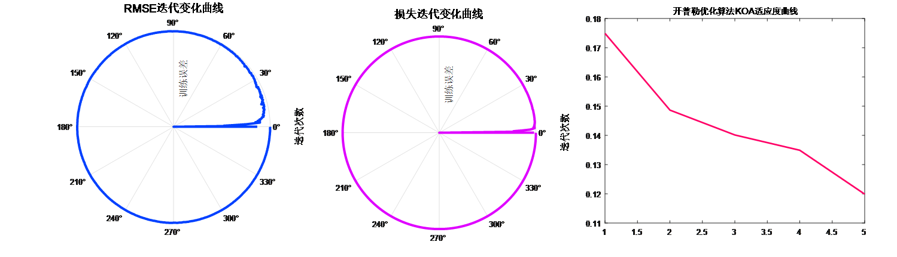

# JCR1 Zone: KOA-CNN-BiGRU-Attention Leading by 24 Steps Multivariate Regression Prediction Algorithm

Program Platform: Suitable for MATLAB 2023 and above versions.
Code Explanation: A forward-looking 24-step multivariate time series regression prediction algorithm based on the Kepler optimization algorithm (KOA), Convolutional Neural Networks (CNN), and Bidirectional Gated Recurrent Unit networks (BiGRU) with an attention mechanism.
The Kepler optimization algorithm (KOA) was proposed by Mohamed Abdel-Basset et al. in 2023, published in the top journal of SCI, Chinese Academy of Sciences, and in the first-tier journal of Knowledge-Based Systems in May 2023. It is inspired by the laws of celestial mechanics and can predict the position and velocity of a planet at any given time. In KOA, each planet and its position are candidate solutions that are randomly updated during the optimization process relative to the best solution so far.
We utilized this newly developed algorithm to optimize the hyperparameters in our CNN-BiGRU-Attention time-series and spatial feature combination-fusion attention mechanism regression prediction program code, forming the KOA-CNN-BiGRU-Attention multivariate regression prediction model.
Functions:
1. Multivariate feature input with single sequence variable output, inputting features from the previous day to make predictions for the next day, achieving a forward-looking 24-step prediction.
2. Optimizing learning rates, convolution kernel sizes, and number of neurons as three key parameters through the Kepler optimization algorithm, aiming to minimize MAPES as the objective function.
3. Providing loss, RMSE iterative change polar coordinates graph; network feature visualization graph; test comparison graph; fitness curve.
4. Providing calculation results such as MAPES, RMSE, MAE, etc.
Applicable fields:
Wind speed prediction, photovoltaic power prediction, power generation power prediction, carbon price prediction, and other applications.
Prediction value vs actual value comparison; training feature visualization:
\n        \n  Training error curve in polar form (error approaching zero from within); fitness curve (error gradually decreasing)

## Images

<!-- PAYMENT_BLOCK -->

## Get this dataset

- Payment link (Stripe): [Buy now](https://buy.stripe.com/3cs8yP7sY87d0vu9AB)
- Payment QR code: 

<!-- /PAYMENT_BLOCK -->
